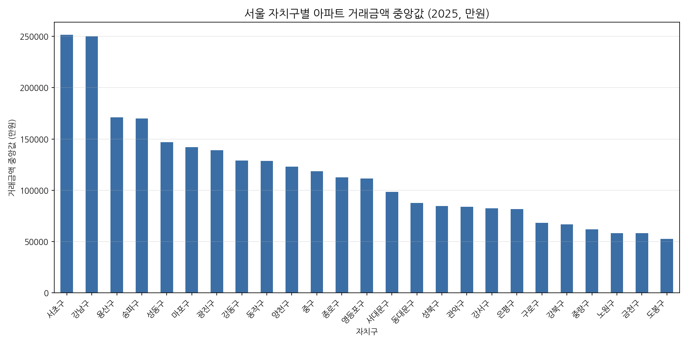
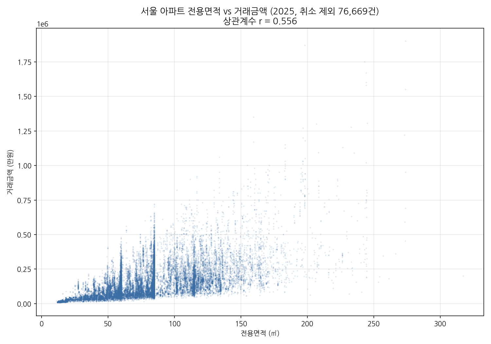

# 08. 서울 아파트 거래가격 예측 모델

서울 아파트 실거래 데이터(2024-11 ~ 2025-12)로 **거래금액을 예측하는 머신러닝 모델**을 만든 실습입니다.
데이터 확인 → 정제 → 선형회귀 → 특성 추가 → 모델 비교(랜덤포레스트·그래디언트부스팅) → 검증 → 경량화까지 단계별로 진행했습니다.

**최종 모델:** 랜덤포레스트 · R² 0.924 · 평균 오차 약 1.1억 · 모델 파일 11MB (처음 100MB에서 경량화)

## 데이터 살펴보기

| 자치구별 거래금액 중앙값 | 전용면적 vs 거래금액 |
|---|---|
|  |  |

- 중앙값이 가장 높은 곳은 서초구·강남구(약 25억), 가장 낮은 곳은 도봉구(약 5억)
- 전용면적과 거래금액의 상관계수는 r = 0.56. 면적만으로는 가격을 절반 정도밖에 설명하지 못함

## 데이터 정제

| 제외한 것 | 건수 | 이유 |
|---|---|---|
| 취소일이 있는 거래 | 6,574건 | 취소된 신고는 실제 거래가 아님 |
| 건축년도가 0 또는 빈칸인 거래 | 1,159건 | 잘못 기록된 사실상 결측값 |

원본 83,243건 → 최종 **75,510건** 사용

## 사용한 특성

| 특성 | 형태 | 설명 |
|---|---|---|
| 전용면적 | 숫자 (㎡) | 가장 중요한 변수 |
| 층 | 숫자 | |
| 건축년도 | 숫자 (연도) | 두 번째로 중요 |
| 자치구명 | 원핫 인코딩 (24개 열) | 위치 효과 |
| 법정동 | 원핫 인코딩 (316개 열, "자치구 법정동") | 같은 구 안에서도 다른 동네 차이 (최종 모델에서 추가) |
| 계약일 | 기준일(2024-11-15)로부터의 경과 일수 | 시간 추세 반영 |
| 신고구분 | 원핫 인코딩 (중개거래/직거래) | |

면적당 단가는 정답(가격)에서 계산되는 값이라 정답이 새어 들어갈 위험이 있어 특성에서 제외했습니다.

## 모델 비교 (테스트 30% 기준)

| 모델 | R² | 평균 오차(MAE) |
|---|---|---|
| 선형회귀 (전용면적만) | 0.313 | 약 5.0억 |
| 선형회귀 (면적·층·건축년도·자치구) | 0.619 | 약 3.6억 |
| 선형회귀 (+ 계약일·신고구분) | 0.621 | 약 3.5억 |
| 로그 변환 선형회귀 | 0.585 | 약 3.4억 |
| 그래디언트부스팅 | 0.821 | 약 2.3억 |
| 랜덤포레스트 (이전 모델) | 0.886 | 약 1.3억 |
| **랜덤포레스트 + 법정동 (최종 모델)** | **0.924** | **약 1.1억** |

랜덤포레스트는 나무 여러 그루가 각기 다른 무작위 샘플로 학습한 뒤 평균을 내는 방식이라, 면적과 지역이 함께 작용하는 것 같은 비선형 관계를 잘 잡아냅니다.

**최종 모델 특성 중요도:** 전용면적 0.36 > 건축년도 0.15 > 강남구 압구정동 0.10 > 서초구 0.06 > 송파구 잠실동 0.04 > 서초구 반포동 0.04

**예측 예시 (최종 모델)**
| 조건 | 예측값 |
|---|---|
| 강남구 대치동, 84.9㎡, 10층, 2015년 건축, 2026-01-01, 중개거래 | 약 40.3억 |
| 도봉구 창동, 59.9㎡, 3층, 2000년 건축, 2026-01-01, 직거래 | 약 5.4억 |

## 검증과 개선: 외운 모델에서 가벼운 모델로

**1. 처음 보는 단지에서는 성능이 낮았다** ([`10_unseen_complex_check.py`](https://github.com/fivcomet/Elice-AX/blob/main/08-seoul-apt-price/10_unseen_complex_check.py))

처음 결과는 거래를 무작위로 나눠, 같은 단지의 다른 거래가 학습과 테스트에 함께 들어간 상태였습니다. 학습에 한 번도 없던 단지만으로 다시 테스트하자 성능이 크게 떨어졌습니다.

| 테스트 방식 | 이전 모델 R² | 최종 모델 R² |
|---|---|---|
| 거래 단위 무작위 분할 | 0.886 | 0.924 |
| **단지 단위 분할 (처음 보는 단지)** | **0.670** | **0.786** |

**2. 모델 파일이 100MB나 됐다** ([`11_model_diet.py`](https://github.com/fivcomet/Elice-AX/blob/main/08-seoul-apt-price/11_model_diet.py))

랜덤포레스트의 용량은 특성 개수가 아니라 나무의 크기가 결정합니다. 이전 모델은 나무 200그루를 "거래 2건만 남을 때까지" 잘게 나눠, 거래를 거의 하나하나 기억하는 상태였습니다.

| 특성 | 나무 수 | 잎 최소 거래 수 | 용량 | R² (무작위) | R² (새 단지) |
|---|---|---|---|---|---|
| 기존 | 200 | 2 | 100.5MB | 0.886 | 0.670 |
| 기존 | 100 | 2 | 50.2MB | 0.884 | 0.669 |
| 기존 | 50 | 5 | 11.0MB | 0.858 | 0.667 |
| **+법정동** | **50** | **5** | **11.0MB** | **0.924** | **0.786** |

- 나무를 절반으로 줄여도 성능은 거의 같았습니다. 200그루는 과했습니다.
- 잎을 덜 잘게 나누면 무작위 분할 점수는 떨어지지만 새 단지 점수는 그대로입니다. 떨어진 만큼이 **외운 부분**이었습니다.
- 대신 법정동 정보를 넣자 **용량은 1/9로 줄고, 새 단지 성능은 0.67 → 0.79로 올랐습니다.** 외우던 위치 정보를 특성으로 직접 알려준 효과입니다.

**그 밖의 한계**
- 처음 보는 단지에서는 평균 오차가 약 2.4억으로, 무작위 분할(약 1.1억)보다 큽니다. 단지별 브랜드·세대수·역세권 같은 정보는 아직 없습니다.
- 학습 기간(2024-11 ~ 2025-12)과 서울 지역을 벗어나면 신뢰도가 떨어집니다. 학습에 없던 큰 면적이나 먼 미래 날짜는 예측할 수 없습니다.
- 예측값은 추정치이며 실제 거래가를 보장하지 않습니다.

## 파일

| 파일 | 내용 |
|---|---|
| [`01_gu_median.py`](https://github.com/fivcomet/Elice-AX/blob/main/08-seoul-apt-price/01_gu_median.py) | 자치구별 중앙값 그래프 |
| [`02_area_price_scatter.py`](https://github.com/fivcomet/Elice-AX/blob/main/08-seoul-apt-price/02_area_price_scatter.py) | 면적-가격 산점도 |
| [`03_check_columns.py`](https://github.com/fivcomet/Elice-AX/blob/main/08-seoul-apt-price/03_check_columns.py) | 건축년도·취소일 이상값 점검 |
| [`04_clean_data.py`](https://github.com/fivcomet/Elice-AX/blob/main/08-seoul-apt-price/04_clean_data.py) | 데이터 정제 → 정제 CSV 저장 |
| [`05_linear_regression.py`](https://github.com/fivcomet/Elice-AX/blob/main/08-seoul-apt-price/05_linear_regression.py) | 선형회귀 (면적만 vs 전체 특성) |
| [`06_add_date_type.py`](https://github.com/fivcomet/Elice-AX/blob/main/08-seoul-apt-price/06_add_date_type.py) | 계약일·신고구분 추가 비교 |
| [`07_all_recommendations.py`](https://github.com/fivcomet/Elice-AX/blob/main/08-seoul-apt-price/07_all_recommendations.py) | 로그 변환·랜덤포레스트·그래디언트부스팅 비교 |
| [`08_save_model.py`](https://github.com/fivcomet/Elice-AX/blob/main/08-seoul-apt-price/08_save_model.py) | 최종 모델 학습 후 `rf_model.joblib`로 저장 |
| [`09_load_and_predict.py`](https://github.com/fivcomet/Elice-AX/blob/main/08-seoul-apt-price/09_load_and_predict.py) | 저장한 모델로 예측 (한 줄씩 주석) |
| [`10_unseen_complex_check.py`](https://github.com/fivcomet/Elice-AX/blob/main/08-seoul-apt-price/10_unseen_complex_check.py) | 처음 보는 단지 기준 성능 확인 (이전 vs 최종) |
| [`11_model_diet.py`](https://github.com/fivcomet/Elice-AX/blob/main/08-seoul-apt-price/11_model_diet.py) | 모델 경량화 실험 (용량·성능 비교) |
| [`rf_model.joblib`](https://github.com/fivcomet/Elice-AX/blob/main/08-seoul-apt-price/rf_model.joblib) | 최종 모델 파일 (약 11MB) |
| [`서울_아파트_실거래가_2025.csv`](https://github.com/fivcomet/Elice-AX/blob/main/08-seoul-apt-price/%EC%84%9C%EC%9A%B8_%EC%95%84%ED%8C%8C%ED%8A%B8_%EC%8B%A4%EA%B1%B0%EB%9E%98%EA%B0%80_2025.csv) | 원본 데이터 (83,243건) |
| [`서울_아파트_실거래가_2025_clean.csv`](https://github.com/fivcomet/Elice-AX/blob/main/08-seoul-apt-price/%EC%84%9C%EC%9A%B8_%EC%95%84%ED%8C%8C%ED%8A%B8_%EC%8B%A4%EA%B1%B0%EB%9E%98%EA%B0%80_2025_clean.csv) | 정제된 데이터 (75,510건, `04_clean_data.py` 결과) |
| [`모델_실행방법.md`](https://github.com/fivcomet/Elice-AX/blob/main/08-seoul-apt-price/%EB%AA%A8%EB%8D%B8_%EC%8B%A4%ED%96%89%EB%B0%A9%EB%B2%95.md) | 내 컴퓨터에서 실행하는 방법 |
| [`프롬프트_정리.md`](https://github.com/fivcomet/Elice-AX/blob/main/08-seoul-apt-price/%ED%94%84%EB%A1%AC%ED%94%84%ED%8A%B8_%EC%A0%95%EB%A6%AC.md) | AI에게 요청한 프롬프트와 결과 정리 |

- 모델 파일은 scikit-learn 1.9.1로 만들었습니다. 버전이 다르다는 경고가 나오면 `08_save_model.py`를 실행해 내 컴퓨터에서 새로 만들면 됩니다.
- 01~04번은 원본 CSV를, 05~10번은 정제 CSV를 읽습니다. `04_clean_data.py`를 실행하면 원본에서 정제 CSV가 똑같이 다시 만들어집니다.
