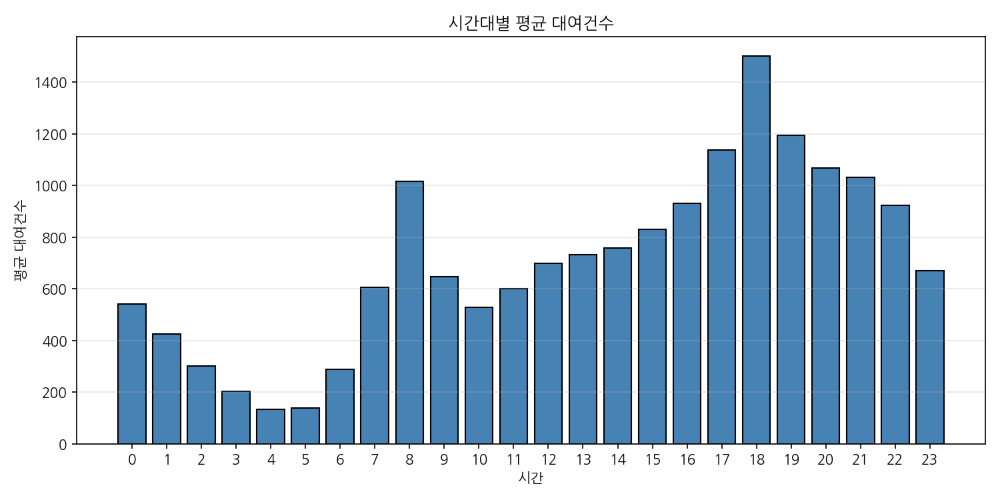
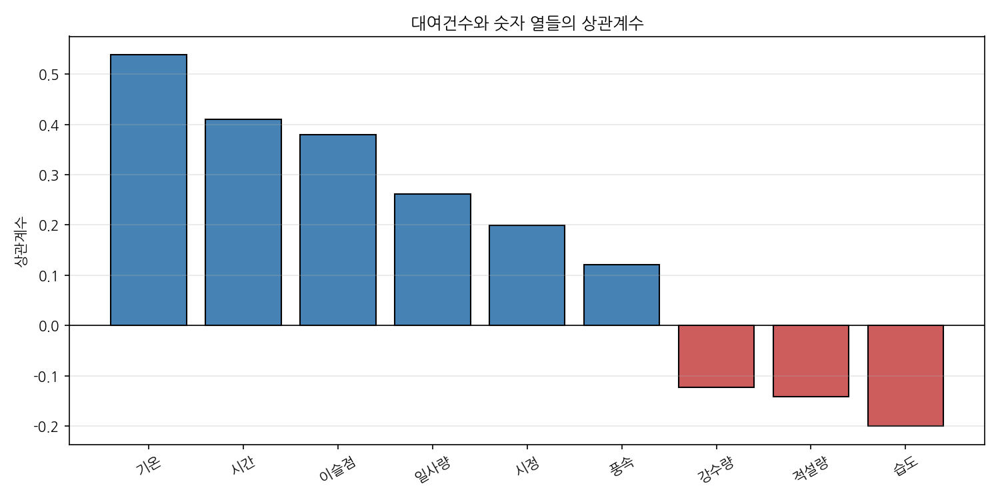

# 09. 따릉이 수요 예측 모델

날씨·시간·날짜 정보로 **시간대별 따릉이 대여건수를 예측**하는 모델을 만든 실습입니다.
데이터를 탐색하며 찾은 특징을 전처리에 반영하고, 선형회귀와 랜덤포레스트를 비교했습니다.

## 데이터

- 서울 따릉이 시간대별 대여 데이터 1년치(2017-12 ~ 2018-11): **8,760행 × 14열** (24시간 × 365일)
- 열: 날짜, 대여건수, 시간, 기온, 습도, 풍속, 시정, 이슬점, 일사량, 강수량, 적설량, 계절, 휴일, 운영일
- 출처: UCI Machine Learning Repository 「Seoul Bike Sharing Demand」 데이터를 한글로 정리한 파일

## 데이터 탐색

| 시간대별 평균 대여건수 | 대여건수와의 상관계수 |
|---|---|
|  |  |

| 발견 | 내용 | 모델에 반영한 방법 |
|---|---|---|
| 출퇴근 피크 | 8시·18시에 대여 최고 (18시 평균 약 1,503건) | 시간을 원-핫 인코딩 24칸으로 변환 |
| 비의 영향 | 비가 오면 평균 766건 → 167건 (**약 78% 감소**, 운영 시간 기준) | "비 여부" 파생 변수 추가 |
| 계절 차이 | 여름 1,034건 > 가을 > 봄 > 겨울 226건 | 계절 원-핫 인코딩 |
| 평일 > 휴일 | 평일이 약 43% 많음 | 휴일 원-핫 인코딩 |
| 기온이 가장 중요 | 상관계수 +0.539 | 그대로 특성으로 사용 |
| 이슬점은 중복 | 기온과 상관 0.914, 빼도 R² 변화 없음 | **특성에서 제외** |
| 미운영 시간 | 대여건수 0인 295줄은 모두 서비스 중단 시간 | 학습 데이터에서 제외 |

비 효과는 강수량의 양보다 **비가 오느냐 마느냐**가 더 컸습니다. 1mm 이하의 약한 비에도 평균 219건으로 급감하고, 그 이상에서는 큰 차이가 없습니다.

## 전처리 (8,760행 → 8,465행 × 42열)

1. 계절, 휴일 → 원-핫 인코딩
2. 시간 → 원-핫 인코딩 (시간_0시 ~ 시간_23시)
3. 날짜 → 월(1~12), 요일(0=월~6=일)로 나눈 뒤 제거
4. 미운영 295줄 제외 (대여 0건은 수요가 없어서가 아니라 서비스가 멈춘 것)
5. "비 여부" 파생 변수 추가 (강수량 > 0이면 1)
6. 이슬점 제외 (기온과 정보가 겹침)

## 모델과 성능

타겟은 대여건수, 특성은 전처리를 마친 40개 열. 학습 70% / 시험 30%(`random_state=21`)로 나눴습니다.

| 모델 | R² | 평균 오차(MAE) |
|---|---|---|
| 선형회귀 (기온만, 비교용) | 0.320 | 396건 |
| 선형회귀 (전체 특성) | 0.682 | 278건 |
| **랜덤포레스트 (전체 특성)** | **0.915** | **112건** |

- 기온 하나보다 전체 특성을 넣으면 R²가 2배 이상 좋아집니다. 시간대·비 여부·계절 정보가 예측의 핵심입니다.
- 랜덤포레스트는 "출근 시간 + 비" 같은 조합 효과를 잡아내서 선형회귀보다 훨씬 정확합니다.

## 추가 검증: 처음 보는 날짜에서도 맞힐까?

무작위 분할은 같은 날의 앞뒤 시간이 학습에 들어가 있어 점수가 좋게 나올 수 있습니다. 그래서 **매달 22일 이후 날짜를 통째로 시험용으로 떼어** 학습에 없던 날을 예측하게 했습니다.

| 모델 | 무작위 분할 | 처음 보는 날짜 |
|---|---|---|
| 선형회귀 | R² 0.682 | R² 0.671 |
| 랜덤포레스트 | R² 0.915 | **R² 0.856** (MAE 145건) |

처음 보는 날짜에서도 성능이 크게 떨어지지 않았습니다. 모델이 데이터를 외운 것이 아니라 날씨·시간과 수요의 관계를 학습했다고 볼 수 있습니다.

## 한계와 다음 단계

- 1년치 데이터라 해마다 달라지는 추세(이용자 증가 등)는 반영하지 못합니다. 실제 서비스라면 과거로 학습하고 다음 해로 시험해야 합니다.
- 날씨 예보 대신 실제 관측값을 썼기 때문에, 실제 예측에서는 예보 오차만큼 정확도가 떨어집니다.
- 특성 중요도 분석, 시간대×날씨 조합 변수, XGBoost 같은 모델로 개선할 여지가 있습니다.

## 파일

| 파일 | 내용 |
|---|---|
| [`bike.py`](https://github.com/fivcomet/Elice-AX/blob/main/09-bike-demand/bike.py) | 데이터 탐색부터 모델 비교·검증까지 전체 코드 (한 줄씩 초보자용 주석) |
| [`따릉이_대여량.csv`](https://github.com/fivcomet/Elice-AX/blob/main/09-bike-demand/%EB%94%B0%EB%A6%89%EC%9D%B4_%EB%8C%80%EC%97%AC%EB%9F%89.csv) | 원본 데이터 |
| [`모델_실행방법.md`](https://github.com/fivcomet/Elice-AX/blob/main/09-bike-demand/%EB%AA%A8%EB%8D%B8_%EC%8B%A4%ED%96%89%EB%B0%A9%EB%B2%95.md) | 내 컴퓨터에서 실행하는 방법 |
| [`프롬프트_정리.md`](https://github.com/fivcomet/Elice-AX/blob/main/09-bike-demand/%ED%94%84%EB%A1%AC%ED%94%84%ED%8A%B8_%EC%A0%95%EB%A6%AC.md) | AI에게 요청한 프롬프트와 결과 정리 |
